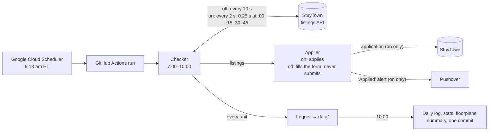

# StuyTown / PCV Affordable Housing Watcher

Watches StuyTown's affordable-housing listings every morning and records
every unit. With auto-apply on, it applies to the ones that fit within a
second and tells you when it did. It runs free on GitHub Actions; nothing runs on your computer. The
design in more depth: [docs/architecture.md](docs/architecture.md).

## How it works



| Time (ET) | What happens |
| --- | --- |
| 6:13 | Google Cloud Scheduler starts the workflow. GitHub's own schedule (6:13–9:43) is a backup. |
| 6:59 | Browsers open with the site already loaded: two to apply if auto-apply is on, one to rehearse if it's off. |
| 7:00–10:00 | **Auto-apply off (collecting data):** it checks every 10 s. The shortest listing so far lasted 25 s, so none are missed. **On:** every 2 s, and every 0.25 s from 3 s before to 15 s after each quarter hour, when StuyTown posts units. The site says it only lists between 7 and 10 AM. |
| New unit | The applier gets it first, then it's logged. Every unit is logged, whether it qualifies or not. |
| 10:00 | A line in [`data/daily_log.md`](data/daily_log.md) (units, beds, rent), stats, new floorplans and the summary page, then **one commit for the day**. Its message says what was listed, e.g. "Fri Nov 6: 4 new listings (6,140 checks)" with one line per unit, or "no new listings". |

## Alerts

| Auto-apply | You get |
| --- | --- |
| **Off** | **No alerts at all.** Every unit is still logged. |
| **On** | One **high-priority** "Applied: Apt …" alert per application that went in, with the unit's address, rent, beds and baths, minimum income, floor, size, finish and layout, and the filled-in form. Nothing for units it didn't apply to (they're logged), and nothing if an application didn't go through (that's on the summary page). |

A GitHub "Run failed" email means something needs fixing (e.g. with
auto-apply on, Pushover keys that can't reach your phone). The run still
watches all morning.

## Rent limits and auto-apply

A unit **qualifies** when its rent is at or under the limit for its bedrooms
and your income is at or above the unit's minimum. `AUTO_APPLY_RULES` sets the
limits: `1:2300` means **1 bedroom or more for $2,300 or less**;
`1:2300, 2:2800` gives 2+ bedrooms their own limit. `AUTO_APPLY_MAX_RENT`, if
set, covers smaller units (studios).

- `AUTO_APPLY_MODE=off`: nothing is ever submitted and no alerts are sent. It
  **rehearses**: the first unit listed each morning gets its form opened and
  filled in from your profile, and every field is checked. **SUBMIT is never
  pressed.** If StuyTown changes the form, the summary page says so the next
  morning.
- `AUTO_APPLY_MODE=on`: it applies to every qualifying unit, **once per unit
  per day**.
  - **Direct:** the application goes straight to StuyTown's API about
    0.1 s after the unit appears, once the request format has been proven
    against the site's current code.
  - **Browser:** otherwise it fills and submits the form in a warm browser,
    in about 1 s. That's also how the format gets proven.
- Then finish the detailed application StuyTown emails you **within 24
  hours**.

Units around $2,100–2,800 have been gone (3 applications taken) 25–81 s
after appearing, which is why applying comes before everything else.

## The data

| File | What's in it |
| --- | --- |
| [`data/daily_log.md`](data/daily_log.md) | One line per morning: how many units, and each one's apartment, beds and rent |
| [`data/summary.md`](data/summary.md) | **Start here.** What needs a look, each morning, every unit (floor, size, rent, finish, layout, features, how long it lasted), layouts with floorplans, patterns |
| `data/events.json` | Every unit ever seen, with the full listing, and every change and removal |
| `data/run_stats/<date>.json` | Each morning: checks, API health, when each unit was posted and how long it lasted |
| `data/applications.json`, `data/apply_runs/` | Each application's result and timeline; redacted recordings of the form |
| `data/floorplans/` | Each layout's floorplan (SVG + PNG) and room sizes |
| [`data/sun/`](data/sun/) | The sun map: which way every apartment line faces and its sun by floor (see below) |

Nothing personal is committed (the repo is public). Your details are
replaced with their key names, and tokens and API keys are scrubbed.

## Sun map: which way a unit faces

Every unit in the alerts and the summary gets a line like

    Faces ESE + SSW (sure) · ~4.3 h morning + 4.9 h afternoon sun a day on floor 7 (Dec 21: 4 h)

An apartment number is floor + line (07-F: floor 7, line F), and every
apartment with the same letter in a building is stacked in the same spot,
so the line letter decides the direction.

- **Map:** download [`data/sun/sun_map.html`](data/sun/sun_map.html) and open
  it in a browser. Look up any unit, see each building's lines floor by
  floor, and rank lines for your floors (mornings first).
- **Lookup:** `python unit_sun.py 287 AVENUE C 07-F`, or `unit_sun.describe(unit)`
  in code. The data is [`data/sun/unit_lines.json`](data/sun/unit_lines.json);
  [`data/sun/units_by_floor.csv`](data/sun/units_by_floor.csv) has every line and floor for a spreadsheet.
- **How sure:** *sure* comes from the building's own 2006 CBRE floor plan,
  or a building of the same design confirmed by several listings.
  *likely* means one direction has 80%+ of the odds. *either way* means two
  answers are about equally good, often north side or south side.
  Buildings with no plan (the Oval ring, 521–525 E 14th, 522–526 E 20th,
  605–625 E 14th, 622–628 E 20th, 315–325 Ave C) are worked out from their
  outline and the listings' Oval / river / Empire State view tags, so their
  answers are odds.
- **Sharper over time:** each morning the watcher saves the market-rate
  listings (`data/sun/market_seen.json`). Rebuild with the **Rebuild sun map**
  workflow (Actions tab), or `pip install -r tools/sun_map/requirements.txt`
  then `python tools/sun_map/build.py`. A line you confirm yourself goes in
  [`tools/sun_map/inputs/line_notes.json`](tools/sun_map/inputs/line_notes.json)
  and fixes every other letter in that building.
- **Sun model:** direct sun on the 21st of each month, with other buildings and
  the building's own wings blocking it. Trees aren't counted. In Stuy Town,
  ESE windows get the morning sun and SSW windows get late morning to
  sunset; floors 6–10 are clear of most shade.

## Settings

Settings → Secrets and variables → Actions.

| Setting | What it is |
| --- | --- |
| Variable `AUTO_APPLY_MODE` | `on` or `off` |
| Variable `AUTO_APPLY_RULES` | Rent limits by bedrooms, $/month, inclusive: `1:2300` = 1+ bedrooms at $2,300 or less; `1:2300, 2:2800` gives 2+ beds their own limit |
| Variable `AUTO_APPLY_MAX_RENT` | Optional: one limit for sizes the rules don't list |
| Secret `APPLICANT_PROFILE` | Your details as one JSON document (`applicant_profile.example.json` shows every key). Keep a copy: GitHub never shows it again |
| Secrets `PUSHOVER_TOKEN`, `PUSHOVER_USER` | Pushover app token and user key |

**All off:** Actions → StuyTown watcher → ⋯ → Disable workflow, and pause the
Cloud Scheduler job.

## Setup (once)

1. **Pushover:** create an application for an API token; note your user
   key; add both as secrets. Buy the app after its 30-day trial, and allow
   high-priority alerts through Focus / Do Not Disturb.
2. **GitHub token** for the 6:13 start: Settings → Developer settings →
   Fine-grained tokens, this repo only, **Actions: Read and write**, longest
   expiry. Set a reminder to renew it.
3. **Google Cloud Scheduler** (free tier; full account, $1 budget alert).
   Create a job:

| Field | Value |
| --- | --- |
| Frequency / Timezone | `13 6 * * *` / `America/New_York` |
| Target | `POST https://api.github.com/repos/cshoffmann/stuytown-affordable-housing-watcher/actions/workflows/watch.yml/dispatches` |
| Body | `{"ref":"main"}` |
| Headers | `Authorization: Bearer <github_pat_…>`, `Accept: application/vnd.github+json`, `X-GitHub-Api-Version: 2022-11-28`, `Content-Type: application/json` |
| Retries | 3, min backoff 30s |

Test it with ⋮ → Force run. Errors: 401 means a wrong token, 403 means no
Actions write access, and 404 means the token isn't scoped to this repo.
Runs that wait behind the main one and then cancel themselves are normal.

## Testing

**Run workflow** (Actions tab) has a button for each check:

| Button | What it does |
| --- | --- |
| *minutes* | A short live run |
| *Send a [TEST] alert* | Proves the Pushover keys work |
| *Test the alerts* | A fake morning through the real code (sends no alerts) |
| *Test auto-apply* | The real applier against a fake form, with your profile |
| *Check the site* | Compares StuyTown's own listings page with what the watcher sees |

On your computer:

```
pip install -r requirements.txt && playwright install chromium
python -m unittest discover -s tests    # everything, offline
python tests/simulate_morning.py        # a fake morning through the real code
python auto_apply.py --selftest         # the real applier against a fake form
python site_check.py                    # the live site vs the watcher
```

## Files

| File | Job |
| --- | --- |
| `watch_loop.py` | The morning run: schedule, workers, wrap-up, commits |
| `check_units.py` | Listings, changes, alerts, events |
| `auto_apply.py`, `direct_submit.py` | The applier: rules, browsers, the direct request |
| `apply_recorder.py` | Redacted recordings of the form |
| `run_stats.py`, `summary.py` | Each morning's stats; the summary page |
| `floorplans.py` | Each layout's floorplan (SVG, PNG, room sizes) |
| `unit_sun.py` | Which way a unit faces and its sun (reads `data/sun/`); saves the market listings it learns from |
| `tools/sun_map/` | Builds the sun map: `build.py`, its inputs (OpenStreetMap outlines, CBRE plan labels, your notes) and the page template |
| `site_check.py` | The live site vs the watcher |
| `background.py` | The alert and logging workers |
| `.github/workflows/watch.yml` | The workflow |
| `.github/workflows/sun_map.yml` | Rebuild sun map (by hand from the Actions tab) |
