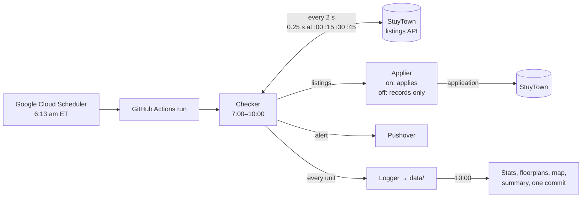

# StuyTown / PCV Affordable Housing Watcher

Watches StuyTown's affordable-housing listings every morning, records every
unit, alerts you to the ones that fit, and can apply for you within a
second. It runs free on GitHub Actions; nothing runs on your computer. The
design in more depth: [docs/architecture.md](docs/architecture.md).

## How it works



| Time (ET) | What happens |
| --- | --- |
| 6:13 | Google Cloud Scheduler starts the workflow. GitHub's own schedule (6:13–9:43) is a backup. |
| 6:59 | Browsers open with the site already loaded: two to apply if auto-apply is on, one to record if it's off. |
| 7:00–10:00 | It checks the listings every 2 s, and every 0.25 s from 3 s before to 15 s after each quarter hour, when StuyTown posts units. The site itself says it only lists between 7 and 10 AM. |
| New unit | The applier gets it first, then the alert goes out, then it's logged. Every unit is logged, whether it qualifies or not. |
| 10:00 | Stats, new floorplans, the apartment atlas, the map and the summary page, then **one commit for the day**. Its message says what was listed, e.g. "Fri Nov 6: 4 new listings (6,140 checks)" with one line per unit, or "no new listings". |

## Alerts

| You get | When |
| --- | --- |
| **Emergency** "Qualifying StuyTown unit – apply now" (or "auto-applying now") | A new unit within your rent limit and income. It breaks through Do Not Disturb, and says so if it's a dream unit |
| "Applied: Apt …" / "Auto-apply failed …" | Auto-apply is on and has a result |
| Nothing | Any other unit (logged only) |
| GitHub email "Run failed" | Something needs fixing, e.g. Pushover keys or the site. The run still watches all morning; it's marked failed at the end |

## Rent limits and auto-apply

A unit **qualifies** when its rent is at or under `AUTO_APPLY_RULES` for its
size (e.g. `1:2300, 2:2800`) and your income is at or above the unit's
minimum. `AUTO_APPLY_MAX_RENT`, if set, covers sizes the rules don't list.

- `AUTO_APPLY_MODE=off`: you get the alert and apply yourself. It only
  records: when the direct request isn't proven for StuyTown's current site
  code, it fills a listed unit's form and presses SUBMIT with every request
  held back, so nothing is sent. Direct submit is then ready the day you
  switch on.
- `AUTO_APPLY_MODE=on`: it applies **once per unit per day**.
  - **Direct:** the application goes straight to StuyTown's API about
    0.05 s after the unit appears. It only does this once the request
    format has been proven against the site's current code.
  - **Browser:** otherwise it fills and submits the form in a warm browser,
    in about 1 s. That's also how the format gets proven.
- Then finish the detailed application StuyTown emails you **within 24
  hours**.

Units around $2,100–2,800 have been gone (3 applications taken) 25–81 s
after appearing, which is why applying comes before everything else.

## Dream units and the map

A **dream unit** has all four:

- rent at or under `DREAM_RULES` (default `1:2200, 2:2700`);
- a floor in `DREAM_FLOORS` (default `5-10`);
- Oval views;
- Oval windows facing E, ESE, SE, S or SW, so a building on the north side of the Oval.

Dream units are highlighted only. Auto-apply follows `AUTO_APPLY_RULES`.

| Rating | Means |
| --- | --- |
| dream | All four |
| possible dream | All four, but the building looks at the Oval two ways and only one is sunny |
| almost | One thing missing; it says which |
| great light | Rent and floor fit, and the windows face E–SW away from the streets (e.g. Peter Cooper Village) |
| price match | Only the rent fits |

**Which way windows face** comes from OpenStreetMap building outlines: each
wall's direction, whether it looks at the Oval, a street or the next
building, and its winter sun hours by floor (NOAA's sun model). A unit
listed with Oval views faces its building's Oval wall, and so does every
apartment on its line (same building and letter, e.g. 06-E and 09-E). Add
what you learn at a viewing to `data/reference/line_overrides.json`.

**Buildings whose Oval windows get sun:** 5, 9, 11, 15, 17, 19 and 21 Stuyvesant
Oval; 272–278 First Ave; 522–526 E 20th St.

**The map:** open [`data/units.geojson`](data/units.geojson) on github.com,
or use the geojson.io link on the summary page (easier on a phone). Tap
anything for details.

| On the map | Means |
| --- | --- |
| Gold building, orange wall | Looks at the Oval from the sunny side |
| Blue building, blue wall | Looks at the Oval from the shady side |
| Green building, green wall | Sunny wall away from the streets, 5+ h of winter sun at floor 8 |
| Grey building | No sunny, quiet walls |
| Gold star, orange star, purple, green, blue, grey dot | A unit: dream, possible dream, almost, great light, price match, the rest |

## The data

| File | What's in it |
| --- | --- |
| [`data/summary.md`](data/summary.md) | **Start here.** What needs a look, each morning, dream units, every unit (zone, floor, size, rent, finish, layout, features, facing, rating, how long it lasted), buildings, layouts with floorplans, patterns |
| [`data/units.geojson`](data/units.geojson) | The map |
| `data/events.json` | Every unit ever seen, with the full listing, and every change and removal |
| `data/run_stats/<date>.json` | Each morning: checks, API health, when each unit was posted and how long it lasted |
| `data/applications.json`, `data/apply_runs/` | Each application's result and timeline; redacted recordings of the form |
| `data/floorplans/` | Each layout's floorplan (SVG + PNG) and room sizes |
| `data/apartment_atlas.json` | Each line of apartments seen: layout, floors, rents, Oval views, facing |
| `data/reference/` | Building outlines and wall analysis (`buildings.json`), your notes (`line_overrides.json`) |

Nothing personal is committed (the repo is public). Your details are
replaced with their key names, and tokens and API keys are scrubbed.

## Settings

Settings → Secrets and variables → Actions.

| Setting | What it is |
| --- | --- |
| Variable `AUTO_APPLY_MODE` | `on` or `off` |
| Variable `AUTO_APPLY_RULES` | Rent limits by bedrooms, $/month, inclusive: `1:2300, 2:2800` (`studio:` works too) |
| Variable `AUTO_APPLY_MAX_RENT` | Optional: one limit for sizes the rules don't list |
| Variables `DREAM_RULES`, `DREAM_FLOORS` | Optional: what counts as a dream unit |
| Secret `APPLICANT_PROFILE` | Your details as one JSON document (`applicant_profile.example.json` shows every key). Keep a copy: GitHub never shows it again |
| Secrets `PUSHOVER_TOKEN`, `PUSHOVER_USER` | Pushover app token and user key |

**All off:** Actions → StuyTown watcher → ⋯ → Disable workflow, and pause the
Cloud Scheduler job.

## Setup (once)

1. **Pushover:** create an application for an API token; note your user
   key; add both as secrets. Buy the app after its 30-day trial, and allow
   Emergency alerts through Focus / Do Not Disturb.
2. **GitHub token** for the 6:13 start: Settings → Developer settings →
   Fine-grained tokens, this repo only, **Actions: Read and write**, longest
   expiry. Set a reminder to renew it.
3. **Google Cloud Scheduler** (free tier; full account, $1 budget alert).
   Create a job:

| Field | Value |
| --- | --- |
| Frequency / Timezone | `13 6 * * *` / `America/New_York` |
| Target | `POST https://api.github.com/repos/cshoffmann/stuytown-affordable-housing-watcher/actions/workflows/watch.yml/dispatches` |
| Body | `{"ref":"main"}` |
| Headers | `Authorization: Bearer <github_pat_…>`, `Accept: application/vnd.github+json`, `X-GitHub-Api-Version: 2022-11-28`, `Content-Type: application/json` |
| Retries | 3, min backoff 30s |

Test it with ⋮ → Force run. Errors: 401 means a wrong token, 403 means no
Actions write access, and 404 means the token isn't scoped to this repo.
Runs that wait behind the main one and then cancel themselves are normal.

## Testing

**Run workflow** (Actions tab) has a button for each check:

| Button | What it does |
| --- | --- |
| *minutes* | A short live run |
| *Send a [TEST] alert* | Proves the Pushover keys work |
| *Test the alerts* | A fake morning |
| *Test auto-apply* | The real applier against a fake form, with your profile |
| *Refresh the map* | Fetches buildings and floorplans, then rebuilds the map |
| *Check the site* | Compares StuyTown's own listings page with what the watcher sees |

On your computer:

```
pip install -r requirements.txt && playwright install chromium
python -m unittest discover -s tests    # everything, offline
python tests/simulate_morning.py        # a fake morning through the real code
python auto_apply.py --selftest         # the real applier against a fake form
python site_check.py                    # the live site vs the watcher
```

## Files

| File | Job |
| --- | --- |
| `watch_loop.py` | The morning run: schedule, workers, wrap-up, commits |
| `check_units.py` | Listings, changes, alerts, events |
| `auto_apply.py`, `direct_submit.py` | The applier: rules, browsers, the direct request |
| `apply_recorder.py` | Redacted recordings of the form |
| `run_stats.py`, `summary.py` | Each morning's stats; the summary page |
| `dream_units.py` | Ratings, facing, the apartment atlas |
| `reference_data.py`, `stuytown_geo.py`, `units_map.py` | Buildings and floorplans; grid, zones and sun; the map |
| `site_check.py` | The live site vs the watcher |
| `background.py` | The alert and logging workers |
| `.github/workflows/watch.yml` | The workflow |

Map data © OpenStreetMap contributors (ODbL).
