# StuyTown watcher: summary

Updated Sat Nov 14, 10:00 AM ET. Auto-apply rent limits: **1 bed <= $2,300, 2 bed <= $2,800**. Direct submit: **ready**.

One line per morning: [daily_log.md](daily_log.md).

## Needs a look

- Alerts can't reach your phone: Pushover rejected the request (HTTP 400): {"user":"valid, but has no active devices","devices":[],"group":0,"licenses":[],"errors":["user is valid but has no active devices"],"status":0,"request":"e7c310ca-195c-414a-9ab4-0f06a211e83f"}. If Pushover says "no active devices", open the Pushover app and buy it after its trial (or re-enable your device at pushover.net), then Run workflow with "Send a [TEST] alert". The run is marked failed until then

## Mornings

| Date | Units posted at (ET) | Qualified | Auto-apply | Checks | API median / p99 |
| --- | --- | --- | --- | --- | --- |
| Sat Nov 14 | none | 0 | - | 1,080 | 18 / 230 ms |
| Fri Nov 13 | none | 0 | - | 6,154 | 18 / 116 ms |
| Thu Nov 12 | 7:15:00 | 0 | - | 6,135 | 70 / 281 ms |
| Wed Nov 11 | none | 0 | - | 6,132 | 75 / 281 ms |
| Tue Nov 10 | none | 0 | - | 6,136 | 71 / 329 ms |
| Mon Nov 9 | 7:15:00 | 1 | - | 6,152 | 18 / 146 ms |
| Sun Nov 8 | none | 0 | - | 6,144 | 29 / 236 ms |
| Sat Nov 7 | none | 0 | - | 6,142 | 45 / 248 ms |
| Fri Nov 6 | 7:15:00, 8:00:00, 8:15:00, 8:30:00 | 1 | - | 6,137 | 44 / 252 ms |
| Thu Nov 5 | none | 0 | - | 6,144 | 41 / 247 ms |
| Wed Nov 4 | 7:15:00, 8:00:00, 8:15:00, 8:30:00 | 1 | - | 6,142 | 42 / 253 ms |
| Tue Nov 3 | none | 0 | - | 6,132 | 74 / 279 ms |
| Mon Nov 2 | none | 0 | - | 6,154 | 11 / 132 ms |
| Sun Nov 1 | none | 0 | - | 6,146 | 39 / 235 ms |
| Sat Oct 31 | none | 0 | - | 6,144 | 39 / 223 ms |
| Fri Oct 30 | none | 0 | - | 6,156 | 12 / 224 ms |
| Thu Oct 29 | none | 0 | - | 6,133 | 60 / 271 ms |
| Wed Oct 28 | none | 0 | - | 6,140 | 34 / 238 ms |
| Tue Oct 27 | none | 0 | - | 6,136 | 62 / 272 ms |
| Mon Oct 26 | none | 0 | - | 6,137 | 75 / 276 ms |
| Sun Oct 25 | none | 0 | - | 6,156 | 11 / 149 ms |
| Sat Oct 24 | none | 0 | - | 6,142 | 40 / 247 ms |
| Fri Oct 23 | none | 0 | - | 6,154 | 11 / 223 ms |
| Thu Oct 22 | none | 0 | - | 6,141 | 41 / 254 ms |
| Wed Oct 21 | none | 0 | - | 6,139 | 43 / 248 ms |
| Tue Oct 20 | none | 0 | - | 6,149 | 30 / 229 ms |
| Mon Oct 19 | none | 0 | - | 6,132 | 53 / 262 ms |
| Tue Oct 13 | 7:15:00, 8:00:00 | 3 | 3 submitted | - | - |
| Mon Oct 12 | 7:15:00, 7:30:00, 8:00:00, 8:15:00 | 2 | 2 submitted | 5,400 | 45 / 258 ms |
| Sun Oct 11 | none | 0 | - | 5,400 | 16 / 224 ms |
| Fri Oct 9 | 7:15:00, 7:30:00, 8:00:00 | 3 | - | - | - |
| Thu Oct 8 | 7:15:00, 7:30:03, 8:00:03 | 2 | - | - | - |
| Wed Oct 7 | 7:15:00, 7:30:00 | 0 | - | - | - |
| Tue Oct 6 | 7:15:00 | 0 | - | - | - |

## Units (last 90 days, newest first)

| Posted (ET) | Apartment | Floor | Beds | Sq ft | Rent | $/sq ft | Min. income | Finish | Layout | Features | Listed for | Qualified | Auto-apply |
| --- | --- | --- | --- | --- | --- | --- | --- | --- | --- | --- | --- | --- | --- |
| Nov 12 7:15:00 AM | 10-C, 285 Avenue C | 10 | 1 | 745 | $4,181 | $5.61 | $143,352 | Modern | [107](floorplans/107.png) |  | 44 min | no |  |
| Nov 9 7:15:00 AM | 08-B, 330 First Avenue | 8 | 2 | 955 | $2,787 | $2.92 | $95,556 | Blank | [126](floorplans/126_st2bedclassic.png) | PS 40 zone, stainless appliances | 23.0 s | yes |  |
| Nov 6 8:30:00 AM | 13-A, 441 East 20th Street | 13 | 1 | 944 | $4,994 | $5.29 | $171,207 | Platinum | [150](floorplans/150.png) | wall A/C, PS 40 zone, Downtown view, closet system, Wood flooring | 90 min | no |  |
| Nov 6 8:15:00 AM | 06-C, 11 Stuyvesant Oval | 6 | 1 | 745 | $3,450 | $4.63 | $118,286 | Classic | [107](floorplans/107.png) | wood floors, renovated bath | 18 min | no |  |
| Nov 6 8:00:00 AM | 07-F, 1 Stuyvesant Oval | 7 | 2 | 932 | $3,263 | $3.50 | $111,883 | Blank | [124](floorplans/124.png) | stainless appliances, Oval views | 39.0 s | no |  |
| Nov 6 7:15:00 AM | 0M-D, 545 East 14th Street | M | 1 | 764 | $2,234 | $2.92 | $76,603 | Blank | [110](floorplans/110.png) | stainless appliances | 71.0 s | yes |  |
| Nov 4 8:30:00 AM | 07-A, 330 First Avenue | 7 | 2 | 967 | $5,631 | $5.82 | $193,063 | Classic | [131](floorplans/131.png) | wood floors, PS 40 zone, renovated bath | 8 min | no |  |
| Nov 4 8:15:00 AM | 05-F, 5 Stuyvesant Oval | 5 | 1 | 745 | $2,184 | $2.93 | $74,875 | Blank | [107](floorplans/107.png) | stainless appliances | 35.0 s | yes |  |
| Nov 4 8:00:00 AM | 10-A, 11 Stuyvesant Oval | 10 | 1 | 771 | $4,878 | $6.33 | $167,252 | Platinum | [102](floorplans/102.png) | dishwasher, wall A/C | 79.0 s | no |  |
| Nov 4 7:15:00 AM | 09-F, 451 East 14th Street | 9 | 1 | 745 | $4,381 | $5.88 | $150,190 | Platinum | [107](floorplans/107.png) | dishwasher, wall A/C | 39 min | no |  |
| Oct 13 8:00:00 AM | 06-D, 605 East 14th Street | 6 | 1 | 764 | $2,125 | $2.78 | $72,847 | Blank | [108](floorplans/108.png) | stainless appliances | 25.0 s | yes | submitted, browser |
| Oct 13 7:15:00 AM | 06-H, 17 Stuyvesant Oval | 6 | 1 | 764 | $2,081 | $2.72 | $71,335 | Blank | [108](floorplans/108.png) | stainless appliances | 53.0 s | yes | submitted, browser |
| Oct 13 7:15:00 AM | 0M-D, 545 East 14th Street | M | 1 | 764 | $2,234 | $2.92 | $76,603 | Blank | [110](floorplans/110.png) | stainless appliances | 81.0 s | yes | submitted, browser |
| Oct 12 8:15:00 AM | 03-B, 610 East 20th Street | 3 | 3 | 1148 | $5,444 | $4.74 | $186,660 | Platinum | [141](floorplans/141.png) | closet system, PS 40 zone, 3 wall A/Cs, open kitchen | 3 min | no |  |
| Oct 12 8:00:00 AM | 02-A, 445 East 14th Street | 2 | 1 | 771 | $2,203 | $2.86 | $75,519 | Blank | [102](floorplans/102.png) | stainless appliances | 40.0 s | yes | submitted, sent 1.03 s after it appeared, browser |
| Oct 12 7:30:00 AM | 06-B, 647 East 14th Street | 6 | 2 | 955 | $3,067 | $3.21 | $105,161 | Blank | [126](floorplans/126_st2bedclassic.png) | stainless appliances | 90.0 s | no |  |
| Oct 12 7:15:00 AM | 08-B, 330 First Avenue | 8 | 2 | 955 | $2,787 | $2.92 | $95,556 | Blank | [126](floorplans/126_st2bedclassic.png) | PS 40 zone, stainless appliances | 40.0 s | yes | submitted, sent 1.18 s after it appeared, browser |
| Oct 9 8:00:00 AM | 10-G, 510 East 20th Street | 10 | 2 | 932 | $2,644 | $2.84 | $90,661 | Blank | [123](floorplans/123.png) | dishwasher, PS 40 zone, extra closet, stainless appliances | up to 75.0 s | yes |  |
| Oct 9 7:30:00 AM | 06-E, 18 Stuyvesant Oval | 6 | 2 | 948 | $2,648 | $2.79 | $90,800 | Blank | [125](floorplans/125.png) | PS 40 zone, stainless appliances, Oval views | up to 90.0 s | yes |  |
| Oct 9 7:15:00 AM | 10-E, 405 East 14th Street | 10 | 1 | 749 | $2,078 | $2.77 | $71,242 | Blank | [119](floorplans/119.png) | stainless appliances | up to 90.0 s | yes |  |
| Oct 8 8:00:03 AM | 01-A, 530 East 20th Street | 1 | 1 | 771 | $3,041 | $3.94 | $104,257 | Blank | [102](floorplans/102.png) | PS 40 zone, stainless appliances | up to 2 min | no |  |
| Oct 8 7:30:03 AM | 05-F, 5 Stuyvesant Oval | 5 | 1 | 745 | $2,184 | $2.93 | $74,875 | Blank | [107](floorplans/107.png) | stainless appliances | up to 5 min | yes |  |
| Oct 8 7:15:00 AM | 09-F, 451 East 14th Street | 9 | 1 | 745 | $4,381 | $5.88 | $150,190 | Platinum | [107](floorplans/107.png) | dishwasher, wall A/C | up to 47 min | no |  |
| Oct 8 7:15:00 AM | 03-D, 455 East 14th Street | 3 | 1 | 749 | $2,033 | $2.71 | $69,690 | Blank | [119](floorplans/119.png) | stainless appliances | up to 108.0 s | yes |  |
| Oct 7 7:30:00 AM | 04-B, 277 Avenue C | 4 | 2 | 932 | $4,503 | $4.83 | $160,094 | Classic | [124](floorplans/124.png) | wood floors | up to 34 min | no |  |
| Oct 7 7:15:00 AM | 02-F, 653 East 14th Street | 2 | 1 | 745 | $4,471 | $6.00 | $153,285 | Modern | [107](floorplans/107.png) |  | up to 49 min | no |  |
| Oct 6 7:15:00 AM | 02-D, 245 Avenue C | 2 | 1 | 790 | $4,405 | $5.58 | $151,042 | Classic | [105](floorplans/105.png) | wood floors, galley kitchen, renovated bath | up to 48 min | no |  |

## Layouts

| Layout | Beds | Sq ft | Seen | Rents | Rooms | Floorplan |
| --- | --- | --- | --- | --- | --- | --- |
| 102 | 1 | 771 | 3 | $2,203-$4,878 | living 12’0” x 18’7”, bedroom 15’0” x 12’0”, dining 9’6” x 9’4”, 4 closets | <a href="floorplans/102.png">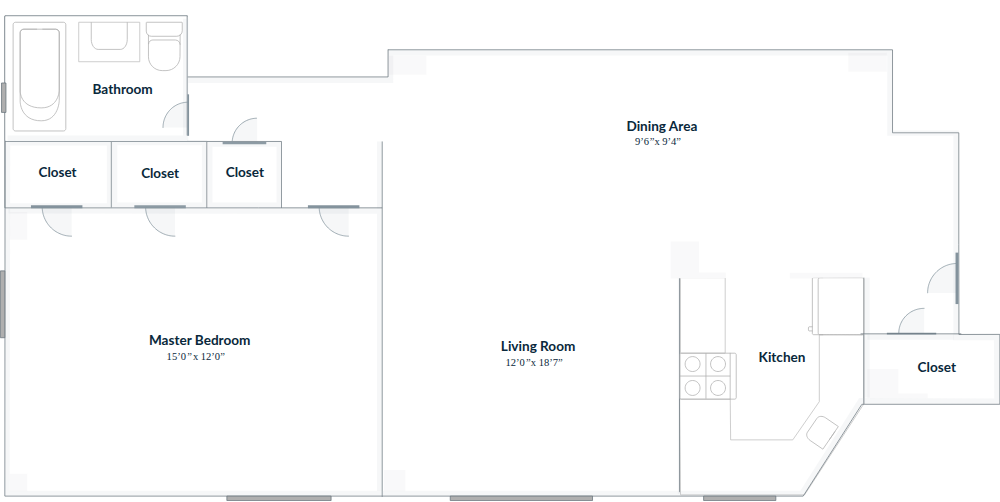</a> |
| 105 | 1 | 790 | 1 | $4,405 | living 12’0” x 18’8”, bedroom 10’4” x 18’8”, dining 8’3” x 9’5”, 4 closets | <a href="floorplans/105.png">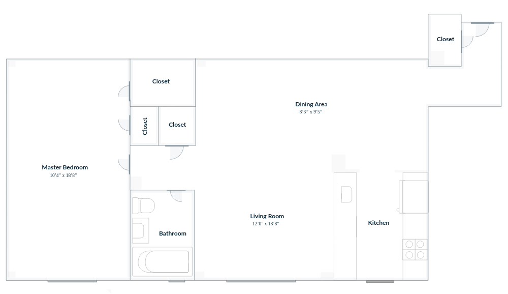</a> |
| 107 | 1 | 745 | 7 | $2,184-$4,471 | living 12’0” x 18’8”, bedroom 10’4” x 18’8”, dining 8’2” x 9’6”, 4 closets | <a href="floorplans/107.png">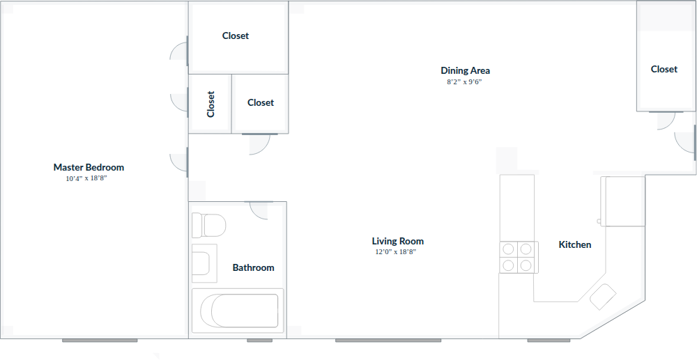</a> |
| 108 | 1 | 764 | 2 | $2,081-$2,125 | living 12’1” x 18’8”, bedroom 15’0” x 12’0”, dining 9’6” x 8’1”, 4 closets | <a href="floorplans/108.png">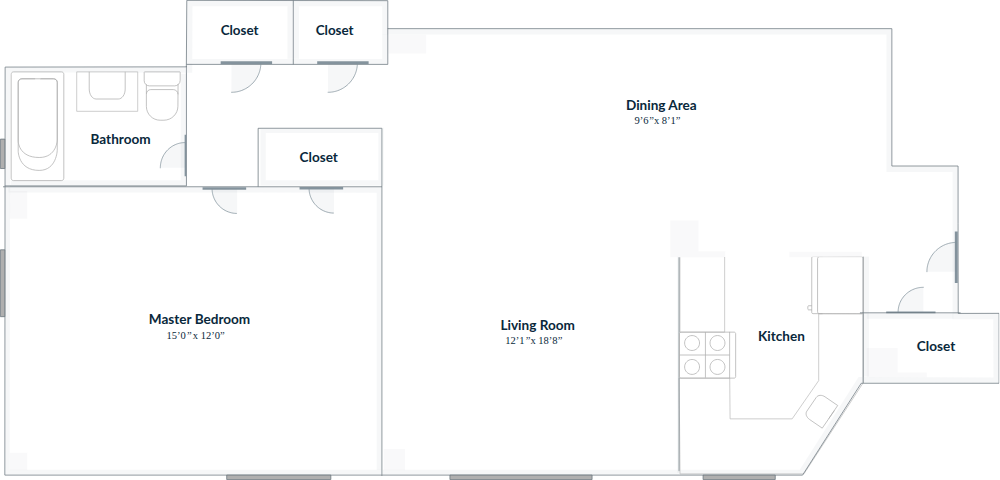</a> |
| 110 | 1 | 764 | 2 | $2,234 | living 11’11” x 18’8”, bedroom 15’0” x 12’0”, dining 9’6” x 9’4”, 4 closets | <a href="floorplans/110.png">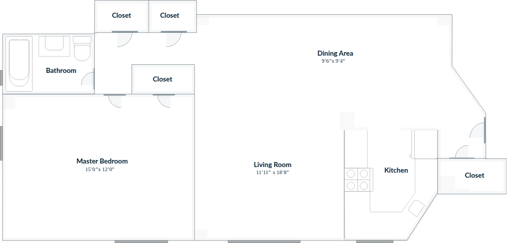</a> |
| 119 | 1 | 749 | 2 | $2,033-$2,078 | living 12’0” x 19’4”, bedroom 12’8” x 14’0”, dining 8’2” x 10’2”, 4 closets | <a href="floorplans/119.png">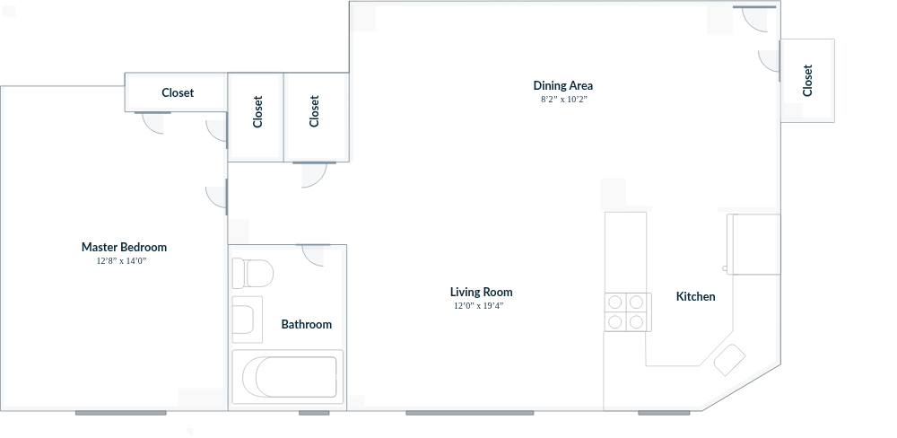</a> |
| 150 | 1 | 944 | 1 | $4,994 | living room | dining room 255” x 151”58” x 60”, bedroom 151” x 138”, 4 closets | <a href="floorplans/150.png">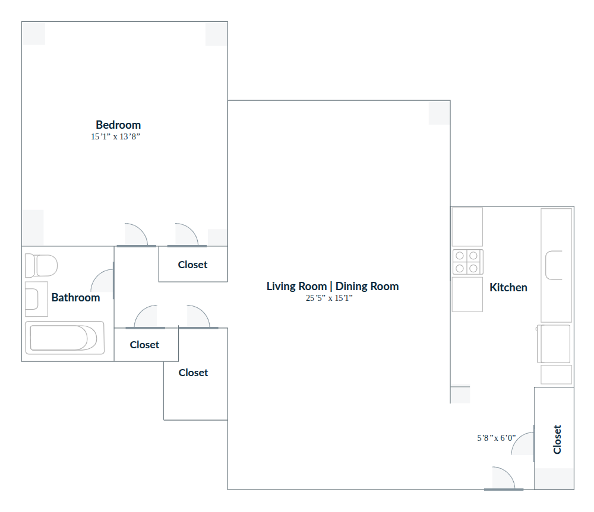</a> |
| 123 | 2 | 932 | 1 | $2,644 | living 12’0” x 18’8”, bedroom 15’0” x 12’0”, bedroom 2 9’2” x 14’4”, dining 8’4” x 9’6”, 5 closets | <a href="floorplans/123.png">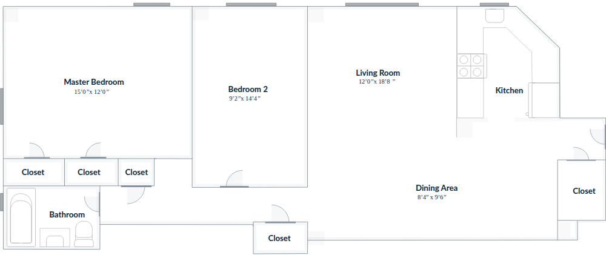</a> |
| 124 | 2 | 932 | 2 | $3,263-$4,503 | living 12’0” x 18’8”, bedroom 11’11” x 15’0”, bedroom 2 9’2” x 14’3”, dining 9’6” x 8’2”, 5 closets | <a href="floorplans/124.png">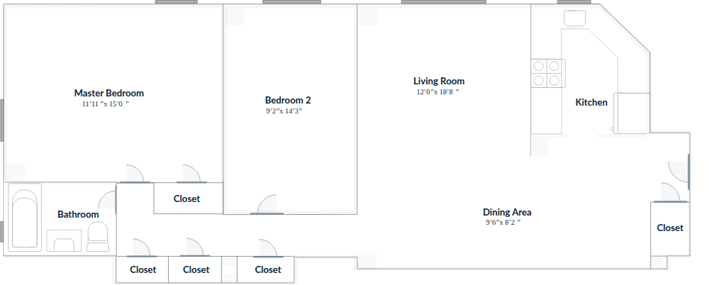</a> |
| 125 | 2 | 948 | 1 | $2,648 | living 12’0” x 18’8”, bedroom 15’0” x 12’0”, bedroom 2 9’2” x 14’4”, dining 9’2” x 9’6”, 5 closets | <a href="floorplans/125.png">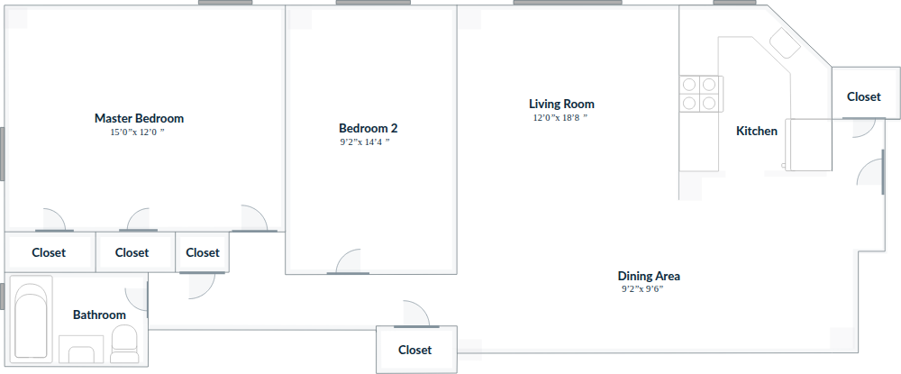</a> |
| 126 | 2 | 955 | 3 | $2,787-$3,067 | living 12’0” x 18’8”, bedroom 15’2” x 12’0”, bedroom 2 9’2” x 14’4”, dining 8’4” x 9’6”, 5 closets | <a href="floorplans/126_st2bedclassic.png">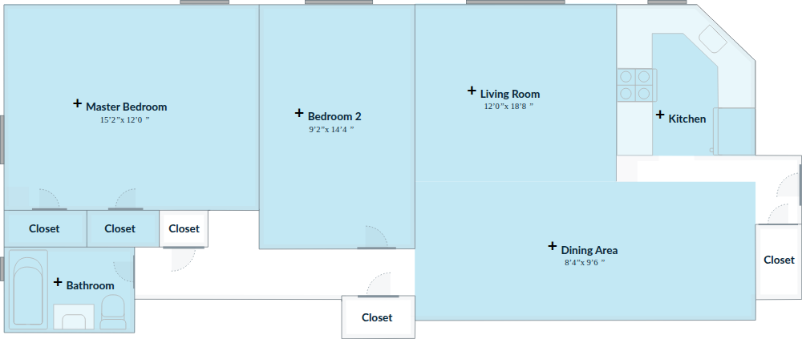</a> |
| 131 | 2 | 967 | 1 | $5,631 | living 12’0” x 18’8”, bedroom 11’11” x 15’0”, bedroom 2 9’3” x 14’3”, dining 8’2” x 9’6”, 5 closets | <a href="floorplans/131.png">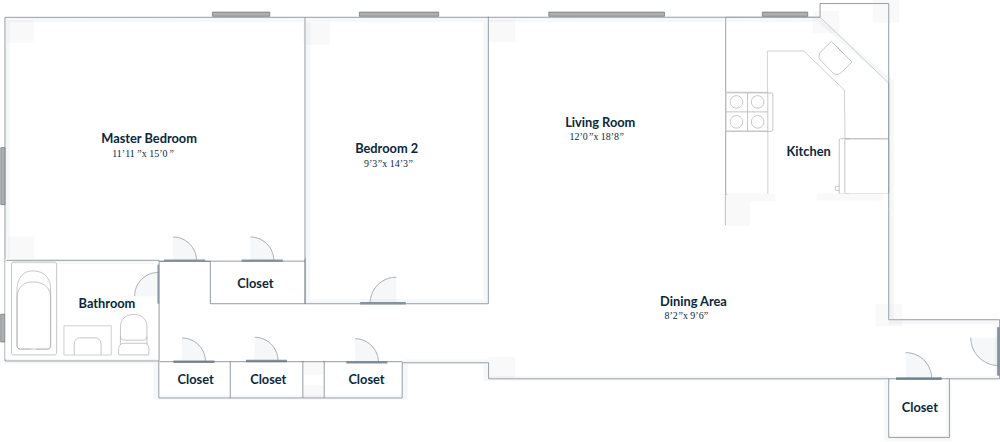</a> |
| 141 | 3 | 1148 | 1 | $5,444 | living 12’0” x 18’8”, bedroom 10’8” x 18’0”, bedroom 2 9’4” x 14’11”, bedroom 3 9’3” x 14’5”, dining 9’6” x 8’2”, 6 closets | <a href="floorplans/141.png">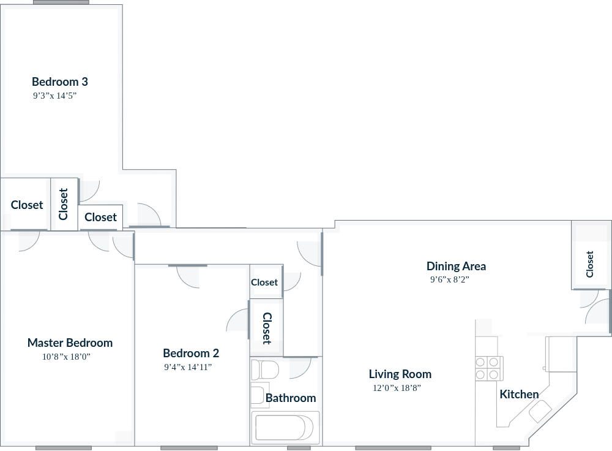</a> |

## Patterns

- **Posting times** (ET, all days): 7:15 ×12, 7:30 ×4, 8:00 ×6, 8:15 ×3, 8:30 ×2
- **Units by weekday:** Mon 5, Tue 4, Wed 6, Thu 5, Fri 7
- **How long units at or under your limit stay listed:** median 40.0 s (fastest 23.0 s, 8 units)
- **How long units over your limit stay listed:** median 8 min (fastest 39.0 s, 9 units)
- **When on the quarter hour they're posted** (their clock, s): -0.14 to +0.11, -0.14 to +0.11, -0.14 to +0.12, -0.14 to +0.12, -0.14 to +0.12, -0.14 to +0.12, -0.14 to +0.11, -0.15 to +0.10
- **Our applications:** 2 sent (2 browser); median 1.1 s from the unit appearing to sending
- **All auto-apply results so far:** 5 submitted

## Feature codes

| Code | Means | Units |
| --- | --- | --- |
| IBSS | Stainless steel appliances | 16 |
| PS40 | PS40 School District | 8 |
| ATW2 | Through wall A/C | 4 |
| DW18 | Dishwasher | 4 |
| NFF | Natural finish wood flooring | 4 |
| MAVM | Renovated bathroom | 3 |
| ELFA | ELFA closet systems | 2 |
| VBOV | Oval Views | 2 |
| ATW3 | 3 Through wall A/C Units | 1 |
| DTVW | Downtown view | 1 |
| OKU | Open kitchen with breakfast bar | 1 |
| PBAC | Extra closet space | 1 |
| PBGK | Galley kitchen | 1 |
| PWF | Wood flooring | 1 |
| FS06 | 6th floor | 5 |
| zCRRE | Platinum finish | 5 |
| FS10 | 10th floor | 4 |
| zMET | Classic finish | 4 |
| FS02 | 2nd floor | 3 |
| FS03 | 3rd floor | 2 |
| FS05 | 5th floor | 2 |
| FS07 | 7th floor | 2 |
| FS08 | 8th floor | 2 |
| FS09 | 9th floor | 2 |
| FS0M | Main level | 2 |
| zROSE | Modern finish | 2 |
| FS01 | 1st floor | 1 |
| FS04 | 4th Floor | 1 |
| FS13 | 13th floor | 1 |
