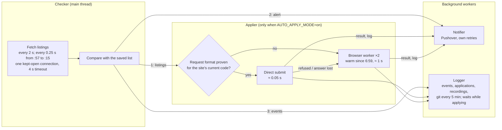
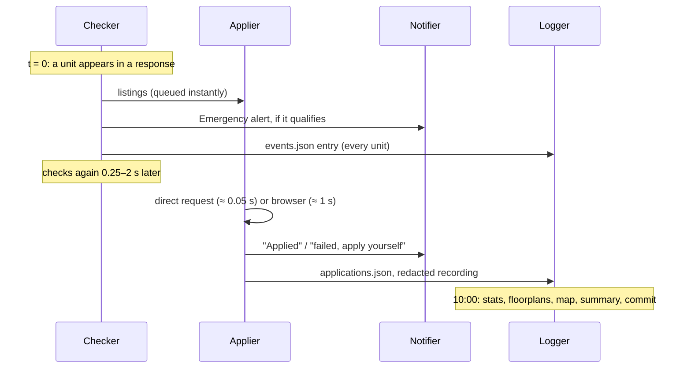

# Architecture

**Goal:** see every listing, and apply to every qualifying unit before its 3
application slots fill. Units are posted on the quarter hour between 7 and
10 AM, and cheap ones have lasted 25–81 s. So the design has one rule:
**the applier always goes first, and nothing else can slow it down or
break it.**

## Components

| Worker | Job | Can it delay an application? |
| --- | --- | --- |
| Checker | Fetches the listings and compares them with the last answer. Never pauses for anything else | It's what finds the unit |
| Applier | Direct request, or a browser that fills and submits the form. Two units can be applied to at once | It is the application |
| Notifier | Pushover alerts, with retries | No: its own thread, and a Pushover failure never stops the run |
| Logger | `data/` files, recordings, batched git commits | No: it waits while an application runs |

## One check

A response that isn't a list of units (an error or maintenance page) is a
failed check, never "zero units". So a site problem can't make listed units
look removed. If the site asks the watcher to slow down (429/403), it
honours `Retry-After` and speeds back up gradually.

## Auto-apply

**Qualifies:** rent ≤ the limit for its bedroom count (`AUTO_APPLY_RULES`,
falling back to `AUTO_APPLY_MAX_RENT`), and your income ≥ the unit's
minimum. Each unit is applied to at most once a day; one listed again on a
later day is applied to again.

**Direct submit** (`direct_submit.py`) sends the same JSON request the site's
form sends, to `pd-dlcore.beamliving.com/affordable-housing/create-application`.
Its safety rules:

1. The format is only learned from a request the site's own form built. That's a
   real browser application, or a recording whose SUBMIT is held back
   inside the browser so nothing is sent.
2. It's saved as rules (phone format, income format, where each field comes
   from), and rebuilding the captured request from your profile must
   reproduce it exactly.
3. It's tied to the site's code version (`aHUnit-js.js.v…`), re-read every
   30 minutes. A site update switches it off until a capture proves the
   format again.
4. A refused or lost direct request goes to the browser. The site refuses a
   second application to the same apartment, so nothing is sent twice.

## After 10:00: floorplans, ratings and the map

With the applier stopped, the logger runs `units_map.refresh_all()`,
time-boxed to 100 s:

1. **Reference data** (`reference_data.py`):
   - It saves each new layout's floorplan: the SVG, a PNG copy and the room sizes.
   - Once, it fetches the complexes' buildings and streets from OpenStreetMap.
   - It casts three rays from each wall to see what the wall looks at: the Oval, a street (First Ave, 14th, 20th, 23rd, Avenue C, FDR), or the next building and how far away it is.
   - From that and NOAA's sun model (`stuytown_geo.py`), it works out the winter sun hours at floors 2, 5, 8 and 11.
2. **Ratings and atlas** (`dream_units.py`):
   - A listing with Oval views (`VBOV`) faces its building's Oval wall, and so does every apartment on its line.
   - Your `line_overrides.json` notes beat that.
   - Without building outlines, the direction is estimated from the building's position.
3. **The map** (`units_map.py`) writes `data/units.geojson`.

In the morning, the only dream-unit work is the alert's one-line note, and
it runs on the notifier.

## What the live site has shown

| Question | Answer |
| --- | --- |
| When are units posted? | Only on the quarter hour: 7:15, 7:30, 8:00 and 8:15 so far. The site says it lists only between 7 and 10 AM |
| How long do they last? | 25–81 s for units around $2,100–2,800; longer for expensive ones |
| What decides who's first? | When the request arrives. We were first on 08-B (Oct 12) with a request 1.2 s after the unit appeared |
| Anti-bot protection? | None: no CAPTCHA, token or challenge |
| The listings API? | `units.stuytown.com/api/ah-units`, the same call the site's page makes. Every answer is a 200 in ~50–75 ms, with no cache and no rate-limit headers. An empty list is 42 bytes |
| Does the site push updates? | No. The page doesn't poll or hold a live connection, so polling is the only way |

## Health

- **Red X / "Run failed" email:** the run still watches all morning, but
  something needs fixing. The log's first lines say what, e.g. Pushover
  keys, or a Pushover account with no active device.
- **"Needs a look"** at the top of `data/summary.md`: a failed application,
  a qualifying unit not tried, the API pushing back, the site's code
  changing.
- **Check the site** (Run workflow button, `site_check.py`): opens the
  listings page in a browser and confirms it calls the same API and sees
  the same units.

## Threads, not asyncio

Playwright's objects belong to the thread that made them, and the form code
is synchronous. So each browser worker is a thread that owns its browser. The
checker, notifier and logger are plain threads joined by queues that never
block, and every background job runs in its own try/except.
