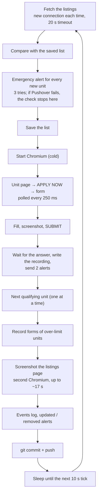
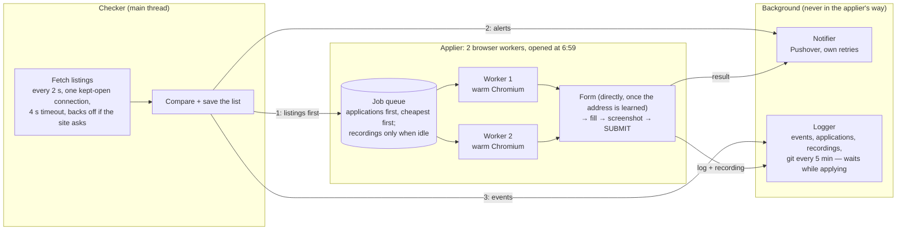
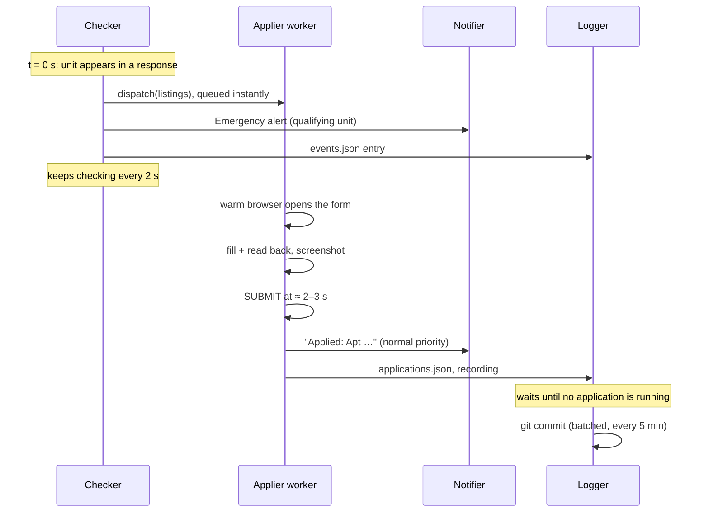
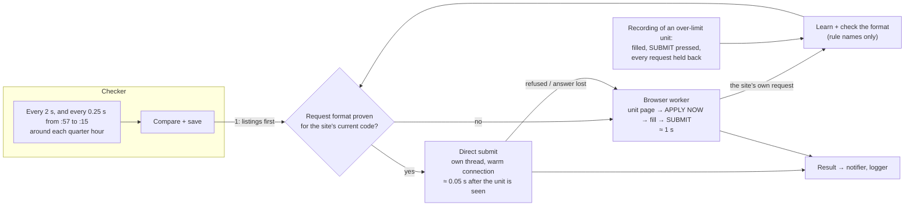

# Architecture: before Phase 1, Phase 1, and Phase 2

The goal hasn't changed: **apply to every unit at or under `AUTO_APPLY_MAX_RENT`
as soon as it appears.** The watcher's own logs show why speed decides it:
the cheap units have been gone (all 3 applications taken) **15–45 seconds**
after appearing, the fastest within 12–27 s of being seen. Phase 1 rebuilds
the watcher so that applying always comes first, and nothing else (alerts,
logging, git) can delay it or break it.

## Before: one loop did everything, one step at a time

Every 10 seconds, a single thread ran this, in this order. Nothing checked
for new units until the last step was done.

What that cost a qualifying unit (posting → SUBMIT, typical case): **≈ 8.7 s**,
of which ~6 s was waiting for the next check, the alert, the browser start
and the saves. On top of that:

- A Pushover outage stopped auto-apply completely, every check.
- After a new unit, checking paused for roughly 8–20 s.
- A second cheap unit waited for the first one's alerts and recording.

## After: four workers, applying first

One check now goes like this:

1. The **checker** fetches the listings over its kept-open connection and
   saves the list.
2. It hands the listings to the **applier**, before any alert is queued.
   `dispatch()` only queues work: a qualifying unit is waiting for a browser
   within microseconds, and the checker is free to check again 2 s later.
3. Only then are the alerts queued for the **notifier**: Emergency for a
   qualifying unit, normal for one that isn't. Events are queued for the
   **logger**.
4. A free **applier worker** opens the unit's form in a browser that has been
   open since 6:59 with the site already loaded. It fills the form, checks
   every field, screenshots it and presses SUBMIT. Two qualifying units are
   applied to at the same time, one per browser.
5. The result goes to the **notifier** (one message: success, or a separate
   failure message) and to the **logger** (applications log, redacted
   recording). The logger waits while any application is running, and
   commits to git every 5 minutes instead of after every change.

## What changed, and what it buys

| Critique item (from the review) | Before | After |
| --- | --- | --- |
| **High:** a Pushover failure stops auto-apply | The alert came first and could fail the whole check | The applier gets the listings first; alerts run on the notifier with their own retries. Bad Pushover keys no longer stop the watcher: it runs, and the job is marked failed at the end |
| **High:** detection waits up to 10 s | Every 10 s, a new connection each time, 20 s timeout | Every 2 s over one kept-open connection, 4 s timeout. It backs off only if the site asks (429/403, honoring Retry-After) and returns to 2 s gradually; plain errors are retried quickly and forgotten on the first good answer |
| **High:** everything is serial | Applying, recordings, screenshots and git all paused checking; units applied to one at a time | The checker never pauses. 2 applier workers apply in parallel. All logging and alerts happen in the background. Recordings of over-limit forms run only when no application is |
| **Medium:** each application starts cold | Chromium launched per check; the site loaded from nothing | Each worker opens Chromium at 6:59, loads the site once and keeps it warm (reloads every 4 min when idle) |
| **Medium:** three page steps before the form | Unit page → APPLY NOW → form, every time | The form's address is learned from the first APPLY NOW, so applications can skip the unit page. *(Removed in Phase 2: the live site showed the form is a dialog on the unit page, so there is no address to skip to. Direct submit replaces it.)* |
| **Medium:** waits poll on a timer | APPLY NOW and the form checked every 250 ms | APPLY NOW is caught on the frame the page draws it (`wait_for_function`, `polling="raf"`); the form search runs every 50 ms |

**Removed:** the listings-page screenshot after every new unit (a second
browser, up to ~17 s of paused checking; the `screenshots/` folder is gone),
the "listing updated" and "no longer listed" alerts (still in `events.json`),
the quiet "After SUBMIT" second alert, the per-change git commits and the
log line on every check (now one status line a minute).

**Alerts now**

| Alert | When | Priority |
| --- | --- | --- |
| Qualifying StuyTown unit – auto-applying now | A new unit at or under your rent limit (and income) | **2 Emergency**, the only one that breaks through Do Not Disturb |
| *(none)* | Any other new unit: logged in `events.json` only *(since 2026-10-19; before, a normal alert)* | |
| Applied: Apt … | The site confirmed the application (filled form attached) | 0 normal |
| Auto-apply failed / unconfirmed: Apt … | Anything else (page attached) | 0 normal |

**Expected time to SUBMIT** (posting → request sent, typical case):
≈ 8.7 s before, about **2–3 s** now. That's 1 s average wait for the next
check, about 0.1 s for the listings, then the form in a warm browser. On the
fake copy of the site the applier submits about 1.0 s after being handed a
unit, going straight to the form. The real site's page times will come from
the first recordings in `data/apply_runs/`.

## Not in Phase 1

Sending SUBMIT's request directly, without a browser, could get to about 1 s.
It needs to see what the real SUBMIT request looks like first, and the
recordings capture exactly that. A wrong direct request can't be taken
back, since the site allows one application per apartment, so it waits for
real data.

## Getting ready for Phase 2: what the live mornings will tell us

Phase 1 was built against a fake copy of the site. What the real site does
can only be measured on it, so every live morning now records what Phase 2
needs to decide its next step. None of it is on the way to SUBMIT: anything
that takes time is read either while nothing is being sent (recordings of
over-limit forms), after the site has answered, or by the background logger.

| Phase 2 question | Where to look |
| --- | --- |
| How long from a unit appearing to SUBMIT, and where does the time go? | `data/run_stats/<date>.json` → `units` → `auto_apply.submit_seconds_after_first_seen`; the stages are in `data/applications.json` → `timeline` (queued, started, form found, SUBMIT pressed, first change, answer) |
| Did we beat the other applicants? | `run_stats` → `units` → `listed_for_seconds`, and `still_listed_seconds_after_submit` for the units auto-apply went for |
| Could SUBMIT be sent directly, without a browser (≈ 1 s faster)? | The recording's `report.json` → `analysis.submit_request`: method, address, content type, header names, the body's field names, any token-like fields or headers. `form_facts` (from the over-limit recordings) shows the form's hidden fields and whether a CAPTCHA widget is on it |
| Does the site confirm it the way `CONFIRMATION` expects? | `report.json` → `notes.text_after_submit_new`: the lines the page gained after SUBMIT. On an "unconfirmed" result, this is what to tune the pattern from |
| Did a field fight back (masks, reformatting)? | The `filled page 1 of the form` step → `fill_details`: per field, how its value went in and the shape it ended in (`+# ### ### ####`) |
| Is there anti-bot protection that a faster or direct approach would trip? | `report.json` → `analysis.anti_bot` (reCAPTCHA, hCaptcha, Turnstile, Cloudflare, PerimeterX, DataDome, Akamai, Kasada, Imperva, Queue-it, F5) and `analysis.cdn`; `cookies` lists their cookies by name |
| Could the checks be faster, or cheaper than fetching every listing? | `run_stats` → `listings_api`: response times, the caching headers (`Age` shows a CDN cache, which would mean faster checks don't see new units sooner), whether `ETag` follows the contents (then a cheap "changed?" request could work), rate-limit headers, and whether the kept-open connection holds |
| Did the site ever push back? | `run_stats` → `listings_api.statuses` and `failures`, and `pace` for every slow-down |
| Does the site poll for new units itself, or hold a live connection? | `run_stats` → `applier.idle_listings_page`: the requests the idle listings page made on its own, per minute, and its WebSockets. A cheaper or faster endpoint would show up here |
| Is the warm browser worth it, and how fast does the form page load? | `run_stats` → `applier.browser_ready_seconds`; `report.json` → `notes.page_facts` (load times, the slowest requests, the framework) |

## Phase 2: what the first live mornings showed, and what changed

Two applications went out on 2026-10-12, and one was the first of its
unit's three. The recordings and the morning's stats answered most of the
open questions:

| Question | What the data showed |
| --- | --- |
| When are units posted? | Always on a quarter hour: 7:15, 7:30, 8:00 and 8:15 on every morning recorded (2026-10-06 to 10-12), seen by the first check at or after it |
| How fast did we apply? | Unit seen → SUBMIT in **1.0–1.2 s**. About 0.75 s of that was loading the unit page (its HTML alone took 0.3 s); the form filled in 0.15 s, plus a 0.12 s screenshot before SUBMIT |
| How fast are the others? | Each cheap unit had its 3 applications within ~40 s. **We were first on 08-B** (7:15, request out 1.2 s after the unit appeared) but not on 02-A (8:00, out 1.1 s after): someone got in under 1.1 s |
| What decides the order? | On 08-B the site's server took 5.9 s to process our application (`submittedOn` 11:15:06.76) and we were still first. So the order seems to follow when requests *arrive*, not when the server finishes them: sending sooner is what counts |
| Anti-bot protection? | **None.** No CAPTCHA, no token in the request, no challenge. The site accepted a browser that announces itself as `HeadlessChrome`. (A `__cf_bm` cookie came from the font service, not StuyTown; the analysis now says which site set each cookie) |
| What does SUBMIT send? | One JSON `POST` to `pd-dlcore.beamliving.com/affordable-housing/create-application` with a `Subscription-Key` header. The address, key, success and error messages and field limits are all in the unit page's own settings (`"applyForm"`) |
| What does the site answer? | `{"token", "status": "Created", "submittedOn", ...}`. At 7:15 the answer took **5.9 s** (busy server); at 8:00 it took 0.6 s |
| Why "unconfirmed" both times? | The success text uses a curly apostrophe (`We’ve sent a link…`), which the confirmation pattern didn't allow, so both waited the full 30 s |
| The listings API? | Median 45 ms, p99 0.26 s, 5,400 requests and every one a 200. Azure Front Door with no caching (`x-cache: CONFIG_NOCACHE`), no ETag and no rate-limit headers. The server closes a kept-open connection after about 120 requests. Its clock matches ours |
| Does the site poll on its own? | No: the idle listings page made no requests and held no live connection |
| Privacy | Two leaks in the committed recordings: the income, sent back as a bare number, and the application's token. Both are fixed, and redaction now goes by JSON key as well as by text |

**Direct submit's safety rules** (`direct_submit.py`):

1. The format is only ever learned from a request the site's **own form**
   built: a real browser application, or a recording whose SUBMIT is held
   back inside the browser (page routes stop every non-GET request, and
   service workers are blocked so nothing can go around them).
2. It's saved as **rule names**: the phone format, the income format,
   where the building address and `version` come from. Rebuilding the
   captured request from the profile with those rules must reproduce it
   exactly. Anything it can't explain, such as a new field, leaves the
   browser in charge.
3. It's tied to the **version of the site's code** (`aHUnit-js.js.v…`),
   re-read from a unit page every 30 minutes. A deploy switches direct
   submit off until a capture proves the format again.
4. A **refused or lost** direct request is handed to the browser. The site
   itself refuses a second application to an apartment, so a request that
   did go through can't be duplicated. That case is reported as
   "unconfirmed, most likely went through".

**Other Phase 2 changes:**
- The browser path takes its result from the API's answer, including
  `submittedOn`, the time on the site's clock, which is what ranks applicants.
- Its screenshot is taken after SUBMIT instead of before.
- The listings connection is renewed just before each burst of checks.
- The run stats record when each unit was posted, to within a check.

**Expected now:** about 0.1–0.3 s from posting to the request reaching the
API, compared with about 1.1 s on 2026-10-12 and about 8.7 s before Phase 1.
On busy mornings the server's own processing (5.9 s at 7:15) can matter
more than any of this, and `site_received_seconds_after_first_seen` in the
stats will show it.

**Still to learn from the next live mornings:**
- What the API answers for "already applied" and "unit full", so that
  `interpret()` can name them from the status code too.
- Whether `version` is the unit's version or always 1. The first capture
  from a unit whose version isn't 1 settles it; until then direct submit
  only runs for units where both readings agree.
- More rankings like 08-B's, to confirm the order follows arrival (one
  morning says so). Your email from StuyTown says which number you were.

## Threads, and why not asyncio

Playwright's objects belong to the thread that created them, and the
form-filling code is synchronous and well tested. So each applier worker is
a thread that owns its own browser. The checker, the notifier and the
logger are plain threads joined by queues. Every cross-thread hand-off is a
queue put that never blocks, and every background job runs in its own
try/except, so a failure there can't reach the checker or the applier.
